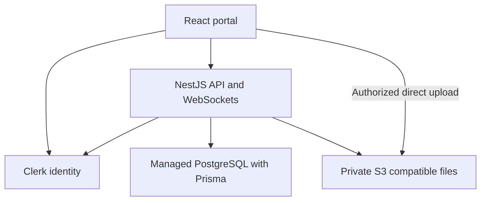

# Architecture

Status: proposed implementation design built around the approved core stack. No application services exist yet.

## Application shape

Use a React single-page application built with Vite and a separate modular NestJS API. This matches the approved separation and supports one long-running WebSocket service. Use one repository with npm workspaces so the frontend and backend can be changed and verified together.

Serve the web application, API prefix and WebSocket endpoint through one portal origin when the provider supports a reverse proxy. This reduces cross-origin configuration. The actual routing and deployment remain conditional on the hosting review; do not configure an unknown host as though it were a Node server.

Project Drive documents open as external links. Cal.com owns booking availability and booking changes. The portal validates and stores the project-specific records needed for its own calendar and history.

## Proposed modules

| Module | Responsibility |
| --- | --- |
| Identity and access | Clerk verification, activation, Owner bootstrap, MFA, project grants |
| Clients and projects | Client profiles, websites, projects, milestones and scoped activity |
| Onboarding | Six steps, questionnaire drafts, access-sharing status and kickoff decision |
| Files and review | Private objects, versions, feedback, approval and lifecycle audit |
| Documents | Authorized Drive-link metadata |
| Messaging | Conversations, membership periods, messages, attachment access and reconnect |
| Billing | Invoices, invoice items, PDF output, payment records and provider events |
| Meetings | Cal.com configuration, verified webhook ingestion and calendar projection |
| Notifications | In-app events, push subscriptions, delivery attempts and user preferences |
| Support | Own ticket creation/history, Owner responses and published help content |
| Audit and jobs | Privileged activity, transactional outbox, retries and approved maintenance |

Use ordinary modules and services. Do not split into microservices for this first release. Proposed modules are an implementation map, not a promise that all business policies have been selected.

## Data model work

Propose the actual schema in P01 before migration. Expected concepts include portal users, activation/invitation records, client profiles, websites, projects, project memberships/grants, milestones, onboarding drafts, Drive documents, files, file versions, feedback, approvals, conversations, membership periods, messages, invoices/items/payments, meetings, notification events/subscriptions, tickets/replies, audit events and outbox records.

Use stable identifiers, foreign keys and transactions. Store timestamps in UTC and display meeting dates in the user's relevant timezone. The planning schedule uses Africa/Lagos. Invoice amounts need a currency and decimal-safe representation; do not derive actual prices or currency from Figma examples.

Access must not follow a company label automatically. Explicit project grants remain authoritative until multi-user company membership rules are selected. Approval and billing-contact grants remain distinct.

## Contracts

Use NestJS OpenAPI DTOs as the reviewed API contract. Generate frontend types from a committed OpenAPI snapshot rather than maintaining divergent copies manually. Define WebSocket event schemas alongside HTTP contracts. Validate client form input and server input independently.

The route names in `SCREEN-MAP.md` are proposed browser routes. No external API endpoint shapes are confirmed by those names. For each task, review the real request/response, errors, authorization, pagination and event semantics before connecting the two applications.

## Consistency and background work

Persist messages before acknowledging or emitting them. Give client sends an idempotency identifier and reconnect using a server-issued cursor. Order history by a stable server sequence/timestamp plus ID, not the sender's device time. Conversation history filters must honor approved membership periods.

Write important domain changes and their outgoing event records in one PostgreSQL transaction. A small outbox worker can retry WebSocket notifications, push delivery and selected integration tasks without adding Redis for the initial single-instance deployment. Do not equate a successful push-service request with delivery to a person's device.

Schedule approved retention/cleanup tasks through an auditable worker. A process restart must not lose a recorded invoice event or file action. Horizontal WebSocket scaling needs a reviewed shared adapter and capacity plan before enabling multiple API replicas.

## Environments

Use separate development, staging and production databases, Clerk instances/keys where supported, private buckets and provider webhook secrets. Keep fixture data out of production. Keep public browser variables separate from server secrets. External service accounts and paid plans require Stephen's choice; nothing in this package provisions them.

## Main failure boundaries

- Authentication may succeed while portal activation or project access is denied.
- S3 upload success does not imply validation or safe release.
- A Cal.com embed callback does not establish a trusted meeting record.
- A payment redirect does not establish a paid invoice.
- A push subscription or old object URL may outlive a browser session unless explicitly handled.
- A restored backup can resurrect deleted content unless deletion records are reconciled.

These are required integration tests, not reasons to change the approved core stack.
